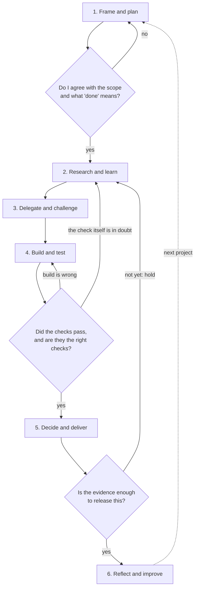
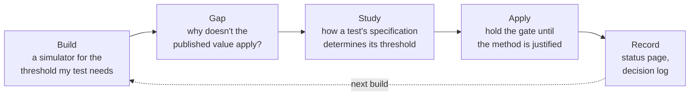

# Guide: the method

This is how I run a project with AI assistance. It has six stages, three points where I have to decide before work continues, and a habit of writing down what was checked.

The examples come from [Project Parallax](https://github.com/MJNolan37/Project-Parallax), an equity-dispersion research project. Its first test needs a statistical threshold, called a critical value. The test is frozen to allow at most two structural breaks (M=2). The widely cited published value is for a test allowing up to five (M=5). The published table does not provide the threshold required by my frozen test specification. Parallax facts in this guide describe the project's public record at one snapshot, October 25, 2026. At that snapshot, calibrating the threshold by simulation was unresolved, as the [status page][a1] records. That unfinished state is why it makes a good example.

## The loop

The diamonds are my decisions. Work does not pass one because a tool says it is finished.

1. **Frame and plan.** Write a short charter: the question, the scope, milestones, what "done" means, and how each piece will be accepted.
2. **Research and learn.** Find the sources, learn the concepts I'm missing, and note where the evidence runs out.
3. **Delegate and challenge.** Send each task to the tool that can reach the material and suits the job. Where it matters, get a separate review, and keep the two views apart until I've read both.
4. **Build and test.** Choose checks suited to the claim, and define acceptance criteria before evaluating the output. Then ask whether the checks themselves are sound.
5. **Decide and deliver.** I decide which problems block release, which can wait, and which proposed remedies to adopt. Only what the evidence supports goes out.
6. **Reflect and improve.** Record what changed in the process and what I learned.

Failures and new evidence send the work backward. At the snapshot, Parallax was paused between stages 4 and 5: the threshold wasn't settled, and the empirical analysis had not been run.

## Who decides what

| AI does within an approved scope | Needs my explicit sign-off | Never delegated |
|---|---|---|
| Drafts plans, text and code | Consequential changes to a method or specification | The research question |
| Searches and summarizes sources | Setting or changing acceptance criteria | The final interpretation of results |
| Writes and runs tests | Opening a stage that was held closed | What is disclosed publicly |
| Makes routine implementation fixes | Releases, and anything published under my name | Statements about my own experience |
| Critiques designs and proposes alternatives | | |

Routine work doesn't wait for me; it proceeds inside a scope I've already approved. A recommendation from a tool, or a finding that something is feasible, belongs in the first column. It becomes a decision only when I make it one.

## Five patterns I rely on

**Finding a problem is not the same as accepting the fix.** A review can be right that something is wrong and still propose a remedy that doesn't follow. I judge the two separately.

**Choose checks suited to the claim, and set the pass rule first.** Choose checks suited to the claim—such as analytically derived examples, invariants, reference implementations or published benchmarks—and define acceptance criteria before evaluating the output. In Parallax, the simulator was compared with the published M=5 benchmark. That comparison exposed an omitted normalization term before any M=2 value was used. But no acceptance rule had been frozen for the comparison, so the project records it as informative, not as a formal validation pass. ([record][a1])

**Examine the check as well as the output.** Failing a check does not, alone, establish that the check is unsound. Parallax produced two separate findings. First, the grid estimates failed the stated convergence criterion. Second, the methods assessment identified that small successive increments would not, by themselves, bound the remaining discretization error. The first says the output wasn't ready. The second says that kind of criterion needed more justification before it could settle the question. ([record][a1])

**An open method question goes back to the evidence, not to a vote.** At the snapshot, Parallax had an unresolved choice between two targets for its calibration: the numerical convention behind the published table, or the continuous-time limit. A question like that stays open until evidence settles it. Counting opinions, mine or a tool's, is not evidence. ([record][a1])

**Freeze decisions before seeing results.** Parallax's rule is that the empirical analysis stays closed while method choices are unsettled, so the method can't be picked to suit the answer.

## Errors caught

Each line is what went wrong, what caught it, and what I decided.

- A simulator omitted a normalization term → the published M=5 benchmark comparison → fixed before any M=2 value was used; the comparison is recorded as informative only. ([record][a1])
- The widely cited threshold belongs to the M=5 setting, and my test specifies M=2 → checking the published table against the specification → I did not borrow it; the threshold is recorded as unresolved. ([record][a1])
- Simulation estimates kept rising as the grid was refined → the stated convergence criterion → no value adopted; at the snapshot, the empirical gate remained closed. ([record][a1])
- My working notes described the simulation runs as independent, while the project's status page says they shared random-number streams → checking sources while drafting this repo → I used the verified wording and flagged the notes for correction.
- An AI assistant's two scores looked like a before and after but measured different things → checking the rubric and the arithmetic → not treated as improvement. ([short example](case-studies/profile-assessment-check.md))

I don't claim these checks make the work more accurate overall. They are specific errors that specific checks caught.

## Documented limits

Some of these are defects in a build. Others are limits on what a finding establishes, or gaps in the record. My records don't establish which tool introduced or caught each one, so I don't assign credit or blame.

| Kind | What the record shows | How I treat it |
|---|---|---|
| Build defect | The first simulator implementation omitted a normalization term | Exposed by the M=5 benchmark comparison before any M=2 value was used; fixed ([record][a1]) |
| Limit of a finding | The M=5 comparison had no acceptance rule frozen in advance | Informative, not a formal validation pass ([record][a1]) |
| Limit of a finding | A redesigned approach was found to be implementable | Feasibility, not acceptance of the design; at the snapshot it had not been run as a calibration ([record][a1]) |
| Gap in the record | A methods review was reported to have concluded that further work was required; the exact response has not been recovered | Unratified. No method is treated as formally accepted on the basis of that unrecovered review ([record][a1]) |
| Gap in the record | Working notes and the public record disagreed on a detail | Published claims must match the verified evidence; discrepancies between working notes and the public record must be reconciled |

## How a build teaches me

Parallax pushed me to evaluate the assumptions behind AI-generated results, not only the results.

The clearest example is the threshold itself. The widely cited value, 8.88, is published for M=5. My frozen test specifies M=2. Changing the maximum number of breaks changes what the test searches over, and so changes its null distribution. Matching the other settings does not make the threshold transferable.

Working through that taught me how a test's specification determines its critical value, and how simulation uncertainty differs from numerical approximation error. It also taught me to keep several milestones apart:

- Fixing a formula error establishes that a particular implementation defect was addressed.
- Matching a published benchmark provides evidence, whose strength depends on the acceptance criteria.
- Running more simulation paths reduces Monte Carlo uncertainty. It doesn't eliminate discretization bias.
- Smaller changes between successive grids don't, by themselves, bound the remaining error.
- A feasible implementation, or a tool's recommendation, doesn't constitute an accepted calibration method.

The practical learning was knowing which questions to ask, and when the evidence remained insufficient to proceed. I can explain these distinctions. That is different from having solved the calibration problem, which I have not. The empirical gate stayed closed because the critical value and its methodological justification remained unresolved.

## If you have one AI tool

The same gates work with a single assistant.

1. **Write the charter yourself**, in half a page: question, scope, what "done" means, what you'll do if a check fails. The [charter template](templates/project-charter.md) is a starting point.
2. **Get a separate review from a fresh session.** Give it only the brief and the output, and ask what could be wrong. A fresh session reduces exposure to the earlier conversation. It is still the same tool, so it does not establish independent verification.
3. **Choose checks suited to the claim**, and write down what will count as a pass before you look at the output.
4. **Keep a decision log.** One line per decision: what you chose, what you rejected, and why. The [decision record template](templates/decision-record.md) is enough.
5. **Sign off yourself.** The tool can say the work is finished. Only you can say it is accepted.

[a1]: https://github.com/MJNolan37/Project-Parallax/blob/38411cc050696efde85d7702c9a11b9ad985c693/docs/A1_STATUS.md
