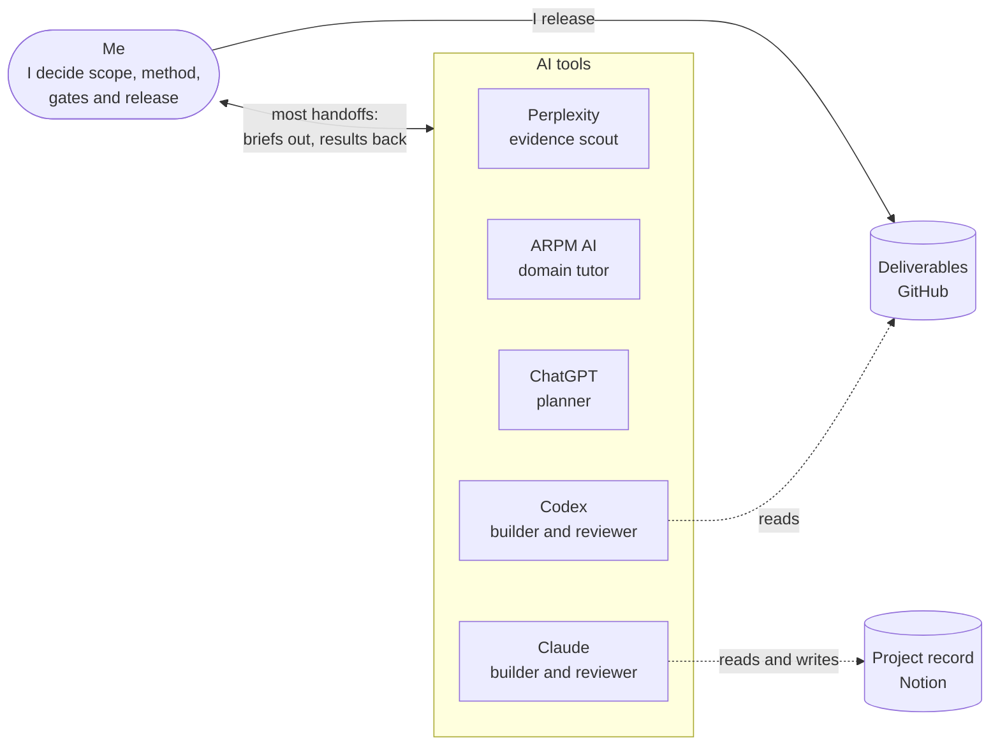

# AI Research Playbook

**How I plan, check and decide when I work across several AI tools, and how each project teaches me something.**

I use AI tools to write and review research code. I own the research questions, methodological decisions and release decisions. This repo shows how I keep it that way.

Three examples, before any process:

- **An error a check caught.** A simulator built for one of my projects omitted a normalization term. A comparison with a published benchmark exposed the omission before any M=2 value was used (M=2 is the setting my test specifies). ([public record][a1])
- **A limit I kept in view.** After the fix, the published benchmark value fell within the simulator's reported 95% Monte Carlo interval. No acceptance rule had been set in advance, so I treat that comparison as informative, not as a formal validation pass. ([public record][a1])
- **A decision I made.** The published table does not provide the threshold required by my frozen test specification. I kept the empirical analysis closed rather than borrow a number that was close. At the project's recorded snapshot (October 25, 2026), the calibration was unresolved and the gate remained closed. ([public record][a1])

## How the work is routed

*A simplified view. The arrows show how information moves, not who decides.* Most handoffs between tools go through me. Some tools can also reach a connected record or repository directly. The dotted lines show direct access that has been demonstrated, with its type. A tool may have other access that isn't drawn here. Access is not authority: scope, methodological decisions, gates and releases are mine.

## What to take away

1. **[How I plan](GUIDE.md#the-loop).** Each project starts with a short charter: the question, the scope, what "done" means, and what happens when a check fails.
2. **[How I keep decision authority](GUIDE.md#who-decides-what).** AI drafts, builds, tests and critiques, and routine fixes proceed within a scope I've approved. My explicit sign-off is reserved for consequential method changes, acceptance criteria, opening a held stage, and releases.
3. **[How a build teaches me](GUIDE.md#how-a-build-teaches-me).** A build surfaces something I can't yet evaluate. I study it, apply it, and write down the lesson.

## Who does what

| Role | Tool | Typical job |
|---|---|---|
| Planner and sounding board | ChatGPT | framing the question, structuring handoffs, critique |
| Builder and reviewer | Claude, Codex | code, repository work, tests, challenging a design |
| Evidence scout | Perplexity | literature and source checks |
| Domain tutor | ARPM AI | a study aid for quantitative methods; no endorsement or formal validation implied |
| Project record | Notion | charters, decisions, handoffs |
| Decision authority | Me | scope, method, gates, what gets released |

Roles overlap and shift as tool access changes. I route work by what a tool can reach and what it is good at, and I use a separate review to catch errors. The limits I've documented are in the [guide](GUIDE.md#documented-limits).

## Read more

- **[GUIDE.md](GUIDE.md)**: the method in five minutes, including a version for someone with one AI tool.
- **Main case study: [The gate that held](case-studies/parallax-validation-gate.md).** A research project where the checks stopped the work at the right moment, and what that taught me.
- **Short example: [checking an AI-generated profile assessment](case-studies/profile-assessment-check.md).**
- **Templates**, each with a filled example: [project charter](templates/project-charter.md), [handoff contract](templates/handoff-contract.md), [decision record](templates/decision-record.md).
- **Projects this draws on:** [Project Parallax](https://github.com/MJNolan37/Project-Parallax) and my [portfolio](https://github.com/MJNolan37/Portfolio).

## What this is, and isn't

**It is** a working method for human-directed research and building with several AI tools, with real examples and their current, sometimes unfinished, status.

**It isn't** an autonomous system, a custom platform or a set of integrations I built. I haven't measured whether using several tools improves accuracy, and I don't claim it does. At its October 25, 2026 snapshot, Project Parallax had not tested its hypotheses; what's shown here is the process around it.

[a1]: https://github.com/MJNolan37/Project-Parallax/blob/38411cc050696efde85d7702c9a11b9ad985c693/docs/A1_STATUS.md

## License

The original text, templates and diagrams are licensed under
[CC BY 4.0](LICENSE.md), except where otherwise noted.
