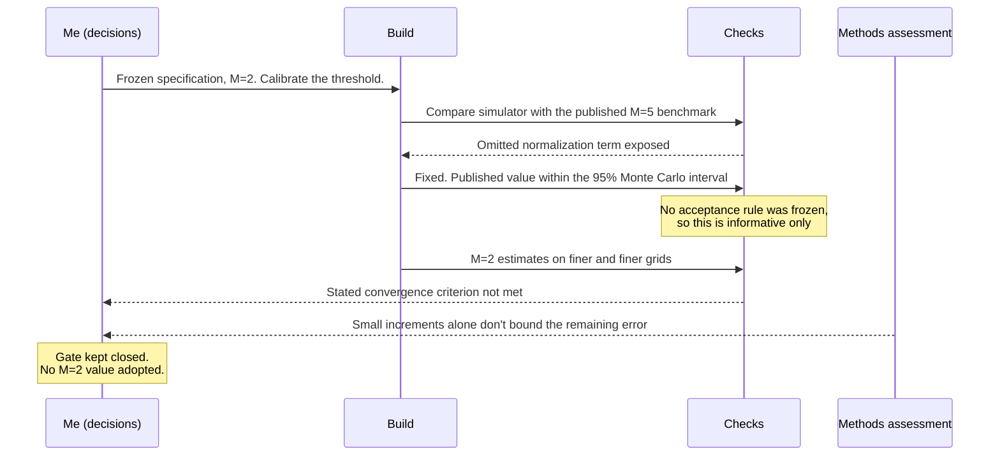

# The gate that held

*A case study from [Project Parallax](https://github.com/MJNolan37/Project-Parallax). Everything here describes the project's public record at one snapshot: October 25, 2026. It does not describe the project's status after that date.*

**In one line:** my test needed a threshold the published table doesn't provide, the work to calibrate one ran into two real problems, and I kept the empirical analysis closed. At that recorded snapshot, the empirical gate remained closed.

**Sources.** The calibration facts come from the project's [status page][a1]. The research aim and the freeze date come from the project's [README][readme]. Both links are pinned to the snapshot. Neither says which tool proposed or challenged what, so this account doesn't either.

## The question

Parallax asks whether firm-specific return variation has changed. Its first test looks for structural breaks, and the frozen test specifies at most two breaks (M=2). The README records that the preregistration states a specification freeze of September 23, 2026, and that no empirical analysis of the hypotheses had been conducted.

To run the test I need a critical value, the threshold a result must exceed. The widely cited value, 8.88, is published for a test allowing up to five breaks (M=5). The published table does not provide the threshold required by my frozen test specification.

## What the AI did

I used AI tools to write a simulator that could calibrate the M=2 threshold, and to run it. A later AI-assisted audit looked at whether a redesigned simulation approach could be implemented.

## What got checked

*The lanes are functions, not tools.*

1. **The benchmark comparison exposed a defect.** The first simulator implementation omitted a normalization term. The published M=5 benchmark comparison exposed this before any M=2 value was used, and the source was fixed. After the fix, the published value fell within the reported 95% Monte Carlo interval. No acceptance rule had been frozen for that comparison, so the project records it as a reported observation. It was informative. It was not a formal validation pass.
2. **The estimates failed the convergence criterion.** The M=2 estimates rose each time the simulation grid was refined, and the stated convergence criterion was not met. The project treats those numbers as finite-grid estimates. None of them is a critical value.
3. **The methods assessment raised a separate problem.** It identified that small changes between successive grids would not, by themselves, bound the remaining discretization error. So the project did not have a defensible rule for when to stop refining.
4. **A method question was open.** The calibration could target the numerical convention behind the published table, or the continuous-time limit. The project had not chosen between them.

## My decision

I kept the empirical gate closed. I did not borrow 8.88, adopt any of the finite-grid estimates, or accept the redesigned approach on the strength of a feasibility finding. The critical value and its methodological justification were unresolved.

## Where it stood

At the October 25, 2026 snapshot, per the [status page][a1]:

- **Blocked.** No M=2 critical value was frozen, provisional or otherwise.
- The choice of calibration target was open.
- The redesigned approach had been found implementable. That is a feasibility finding. It had not been run as a calibration.
- A methods review was reported to have concluded that further work was required. The exact response had not been recovered and was not ratified. No method is treated as formally accepted on the basis of that unrecovered review.
- **No hypothesis in Parallax had been tested.**

## The lesson

The gate did its job by stopping the work before a convenient number could be used. This case had no resolved ending at the snapshot, and it doesn't need one to be useful. A method that only ever reports success isn't being checked very hard.

Two habits carry over to other projects. Define the acceptance criteria before evaluating the output, because a comparison without them can inform but can't certify. And treat "it can be built" and "a tool recommends it" as inputs to a decision, not as the decision.

## What I learned

Parallax pushed me to evaluate the assumptions behind AI-generated results. This episode made me study how a test's specification determines its critical value, and how simulation uncertainty differs from numerical approximation error.

The clearest example is why 8.88 didn't apply. Changing the maximum number of breaks changes what the test searches over and its null distribution. Matching the other settings doesn't make the threshold transferable.

I can explain why the evidence was insufficient to proceed. That is different from having solved the calibration problem, which I have not. The fuller list of distinctions is in the [guide](../GUIDE.md#how-a-build-teaches-me).

[a1]: https://github.com/MJNolan37/Project-Parallax/blob/38411cc050696efde85d7702c9a11b9ad985c693/docs/A1_STATUS.md
[readme]: https://github.com/MJNolan37/Project-Parallax/blob/38411cc050696efde85d7702c9a11b9ad985c693/README.md
