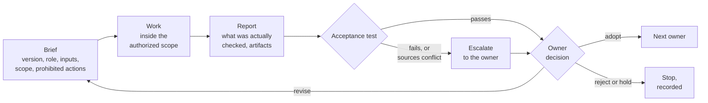

# Handoff contract

A handoff is the moment work moves from one tool, or one session, to the next. Most of mine go through me. The contract turns "here's what I did" into something the receiver can test.



## Template

```markdown
# Handoff: <task>

1. Governing brief:      <which brief or decision this work answers to, with its version>
2. Role this turn:       <builder, reviewer, researcher...; and what the role is not>
3. Inputs:               <what was provided, and which source is authoritative>
4. Authorized scope:     <what may be done>
5. Prohibited actions:   <what may not be done>
6. What was checked:     <exactly what was verified, and what was not>
7. Acceptance test:      <how the receiver can tell the work is acceptable>
8. Escalation:           <what stops the work and sends it back to the owner>
9. Artifacts:            <files or outputs produced>
10. Next owner:          <who acts next>

Owner decision: adopt / revise / reject / hold
```

Field 1 matters more than it looks: work can be correct against last week's brief and wrong against today's. Field 6 is where most of the value is. "File created", "checks run locally" and "seen working where it will be used" are different states, and the report should say which one applies.

## Filled example: the first README and guide handoff for this repository

This shows one point in time: the first draft of the README and guide, handed to me for review. An AI builder drafted them under my brief. What happened afterwards is listed separately at the end.

> **Handoff: first draft of README and GUIDE**
>
> 1. **Governing brief:** build brief v1.3, November 15, 2026, with the instructions I gave when I approved the build plan.
> 2. **Role this turn:** builder, drafting. Not reviewer, and not the one who decides what is published.
> 3. **Inputs:** the Project Parallax status page at a pinned commit, authoritative for Parallax facts; my written statement of what I learned; my working notes for the short profile example.
> 4. **Authorized scope:** draft two files locally.
> 5. **Prohibited actions:** publishing or pushing anything; editing any other repository; assigning credit or blame to a tool where the record doesn't establish it.
> 6. **What was checked:** the three diagrams rendered in a local renderer, light theme; a scan of both files for private or excluded terms; Parallax statements compared with the status page at the pinned commit. **Not checked:** how the diagrams render on GitHub, in either theme. **Known gap:** links to the case studies and templates pointed at files that did not exist yet.
> 7. **Acceptance test:** my review against the brief's checklist.
> 8. **Escalation:** if two sources disagree, stop and flag it to me. This fired once: my working notes and the status page described the simulation runs differently.
> 9. **Artifacts:** README.md, GUIDE.md, and a private review log kept outside the repository.
> 10. **Next owner:** me.
>
> **Owner decision: revise.** I returned nine corrections, among them narrowing a claim about what had been published, and separating who can access a record from who decides.

**After this handoff** (separate, later results): the corrections were applied and reviewed in further rounds; the remaining files were drafted; the diagrams rendered in the local renderer and the internal links resolved. Rendering on GitHub remained unchecked.
